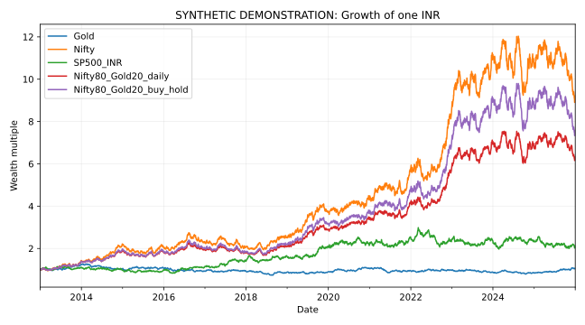
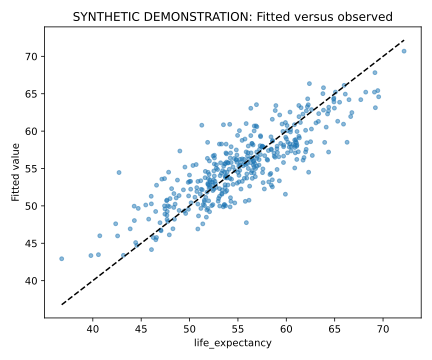
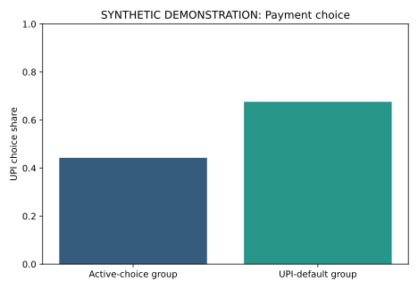
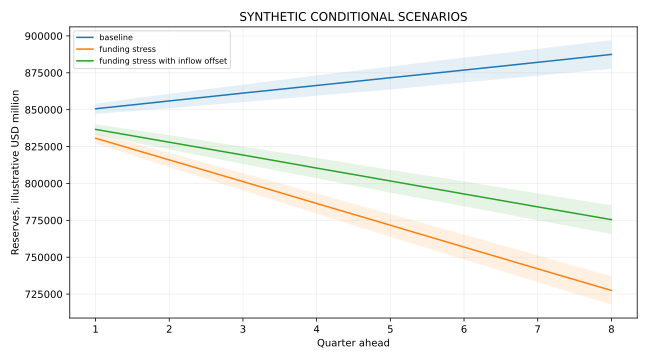
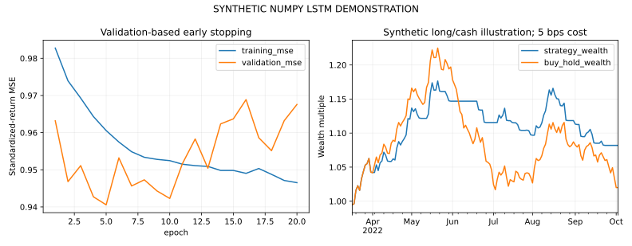

# Results gallery

Each caption states whether the figure is synthetic, illustrative or drawn from an archived published-data appendix.

## Gold versus Equities in India

All values below are synthetic or illustrative workflow results.

[Open project](../projects/gold-vs-equities-india/)

## Econometrics Research Toolkit

All values below are synthetic or illustrative workflow results.

[Open project](../projects/econometrics-research-toolkit/)

## Derivatives and Portfolio Risk Lab

All values below are synthetic or illustrative workflow results.

[Open project](../projects/derivatives-and-portfolio-risk-lab/)

## Digital Payments and Default Choice

All values below are synthetic or illustrative workflow results.

[Open project](../projects/digital-payments-choice-experiment/)

## BHARAT-FX

All values below are synthetic or illustrative workflow results.

[Open project](../projects/bharat-fx/)

## India External-Sector Forecasting

All values below are synthetic or illustrative workflow results.

[Open project](../projects/india-external-sector-forecasting/)

## ARMA Simulation with Student-t Innovations

All values below are synthetic or illustrative workflow results.

[Open project](../projects/arma-student-t-simulation/)

## LSTM Time-Series and Trading Workflow

All values below are synthetic or illustrative workflow results.

[Open project](../projects/lstm-time-series-lab/)

## Behavioural Responses to Economic Recessions

[Read the research overview](../projects/behavioural-recessions-review/). The full recovered review and its appendix figures are prepared separately.
