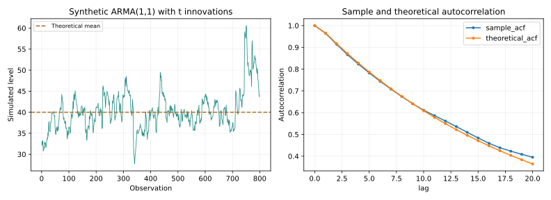

# ARMA Simulation with Student-t Innovations

ARMA(1,1) simulation with variance-normalised Student-t shocks, analytical moments, Monte Carlo diagnostics and MATLAB companion scripts.

**Research question:** How do persistence and heavy-tailed innovations affect finite-sample behaviour in a stationary ARMA process?

**Public edition:** New executable Python reference and reconstructed MATLAB companion scripts. Original local source files were not recovered.

**8 functional checks passed locally**, plus a complete demonstration run.

## What you can inspect

- Simulate a stationary ARMA(1,1) recurrence with explicit initialisation and burn-in.
- Rescale Student-t innovations to the requested finite variance.
- Derive unconditional mean, variance and autocorrelation analytically.
- Cross-check analytical results against statsmodels ArmaProcess.
- Report 200 seeded finite-sample replications and preserve the historic MATLAB parameter setting.

## Results preview

All values below are synthetic or illustrative workflow results.



| Moment | Theoretical | One simulated sample |
| --- | --- | --- |
| Mean | 40 | 40.3444 |
| Variance | 15.7692 | 21.7934 |

The sample variance differs visibly from its theoretical value, illustrating finite-sample dispersion under persistence and heavy tails. Two hundred seeded replications are provided rather than hiding this variation. MATLAB companion execution is not claimed.

## Run the example

Use Python 3.12. From this project's directory:

```bash
python -m pip install -r requirements.txt
python -m unittest discover -v
python simulation.py --output demo_output
```

For an isolated environment, run `python -m venv .venv` first. Activate it with `source .venv/bin/activate` on Linux/macOS or `.venv\Scripts\activate` on Windows. The standard example runs offline after dependencies are installed.

The [notebook walkthrough](notebooks/01_results_walkthrough.ipynb) explains the saved outputs. Exact command-line options appear in [CLI.txt](docs/CLI.txt).

## Documentation

| Guide | What it covers |
| --- | --- |
| [Methods](docs/METHODS.md) | Formulas, assumptions and interpretation |
| [Data dictionary](docs/DATA_DICTIONARY.md) | Variables, units and validation rules |
| [Results](docs/RESULTS.md) | Actual bundled output and how to read it |
| [Reproducibility](REPRODUCIBILITY.md) | Commands, checks and the recorded environment |
| [Provenance and attribution](docs/PROVENANCE.md) | Historical context, reconstruction and contribution |
| [Roadmap](docs/ROADMAP.md) | Specific extensions, with unfinished work labelled |
| [References](docs/REFERENCES.md) | Method documentation and source links |

## Limits of interpretation

- MATLAB/Octave was unavailable, so companion MATLAB scripts were not executed.
- The Python edition uses 500 burn-in observations; the earlier exercise used 50.
- At nu=4, the innovation fourth moment is infinite; variance estimates can be unstable.
- These simulations are demonstrations rather than fitted economic models.

## Contribution and research context

Documented December 2024 MATLAB exercise using c=2, phi=0.95, theta=0.25, nu=4, T=800 and a 50-observation burn-in.

Arinjai Das developed the earlier simulation exercise through ChatGPT-assisted work. The October 2026 public reconstruction adds explicit innovation scaling, theoretical comparisons and numerical verification. Earlier execution is not inferred from the existence of drafted scripts.

**Skills demonstrated:** Python, MATLAB, ARMA, Monte Carlo, Student-t distributions, time-series theory, numerical verification.

[Portfolio](https://github.com/arinjaidas/My-Projects) · [GitHub profile](https://github.com/arinjaidas)
