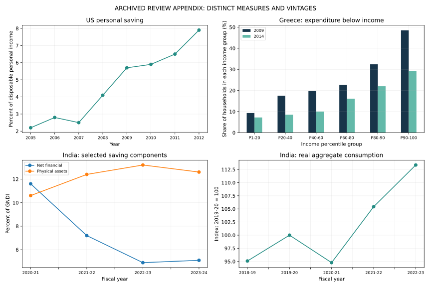

# Results walkthrough

These are archived published aggregate observations retained from the review appendix, with their original source vintages.

| Arithmetic check | Maximum absolute index discrepancy |
| --- | --- |
| US consumption index | 0.00357317 |
| India consumption index | 0.00476848 |

Both discrepancies lie within the 0.015-point rounding tolerance. This verifies appendix arithmetic; it does not establish a common saving measure or a causal recession effect.

The numerical files in [demo_output](../demo_output/) are the authoritative bundled artifacts. Re-run the entry command to reproduce the workflow. Figure metadata can differ across renders even when the underlying numerical example is unchanged.
