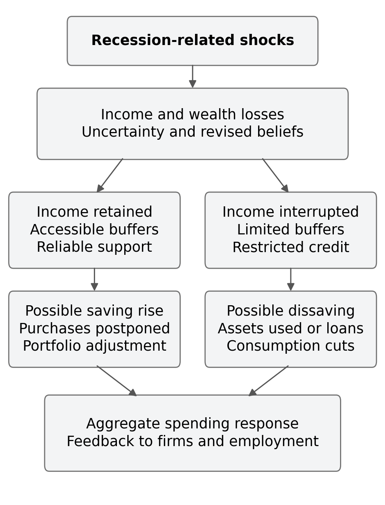
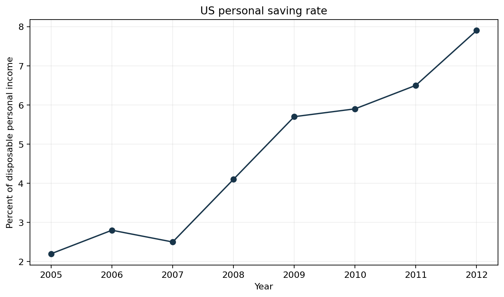
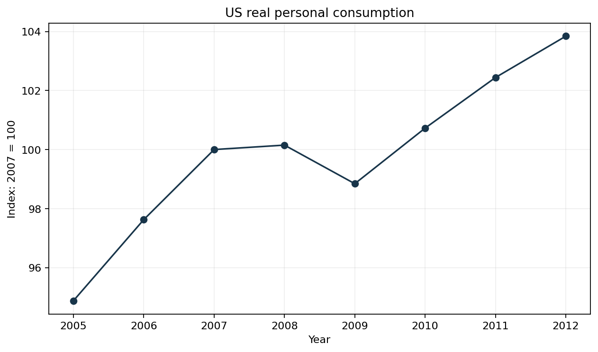
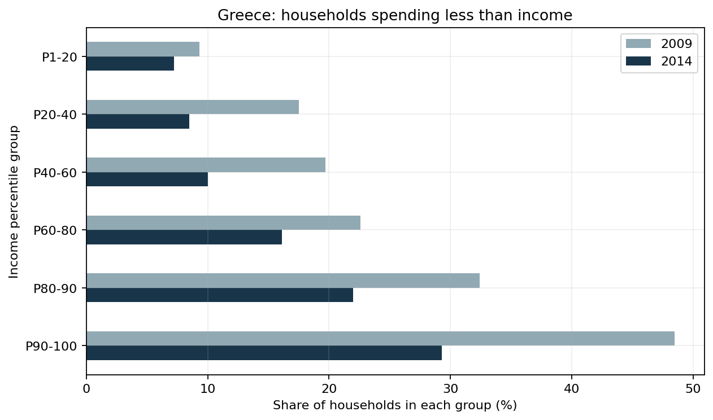
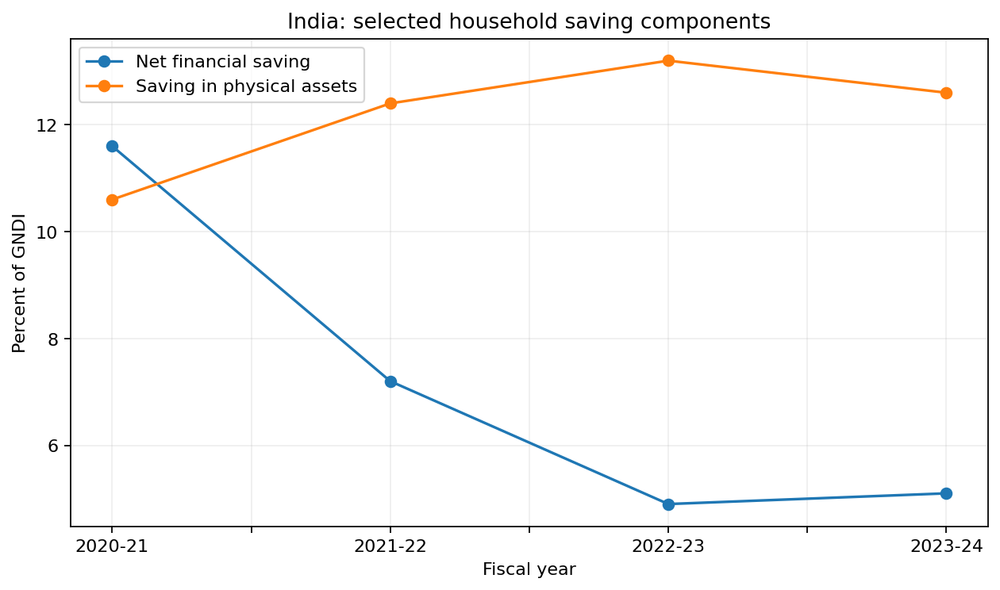
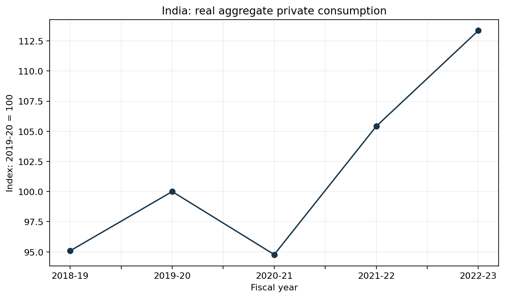

# Behavioural Responses to Economic Recessions

**Portfolio research draft. Narrative review, with no new household survey or original econometric estimates.**

Converted from the September 2026 manuscript. Its original sources and statistical vintages are retained. This draft is not presented as a peer-reviewed publication or an institutional endorsement.

REVIEW ARTICLE

Behavioural Responses to Economic Recessions: Changes in Saving, Consumption, and Risk-Taking Behaviour

Gokhale Institute of Politics and Economics, Pune, India

## ABSTRACT

Aims: To examine how recessions influence household saving, consumption and financial risk-taking, and explain why similar increases in uncertainty can generate different responses across households and economic settings.

Study Design: An analytical narrative review combining household economic theory, behavioural explanations, published empirical research and comparative historical case studies.

Place and Duration of Study: The review focuses on the United States during the Great Recession of 2007-2009, Greece during the sovereign debt crisis and its aftermath, and India during the COVID-19 recession and subsequent recovery. A complementary discussion examines the long-term effects of personally experienced macroeconomic returns. Sources were checked on 2 September 2026; the historical windows and statistical vintages are identified separately.

Methodology: Selected academic studies and official statistics are organised around income, wealth, liquidity, uncertainty, beliefs and institutions. Six figures illustrate the analytical framework and verified descriptive evidence. The study does not collect household survey data, estimate a new regression or claim an exhaustive systematic review.

Results: Recessions can increase the desire to accumulate precautionary balances while simultaneously reducing the resources available for saving. Consumption responses depend on income persistence, credit access and expenditure composition. Greece illustrates severe saving constraints, while India's pandemic experience highlights restricted consumption opportunities alongside unequal income losses. Evidence on financial risk-taking indicates that beliefs and risk tolerance can change after adverse experiences, but portfolio movements alone cannot establish a change in preferences.

Conclusion: Household responses to recessions reflect interactions between psychological mechanisms and material constraints. Effective stabilisation requires protection of essential consumption, attention to liquidity and credible policy implementation. Aggregate saving increases should not be interpreted as evidence that all households have become financially more secure.

Keywords: Economic recession; behavioural economics; precautionary saving; household consumption; financial risk-taking; liquidity constraints; uncertainty; experience effects.

## 1. INTRODUCTION

Economic recessions are usually described through movements in output, employment, investment and aggregate demand. Their consequences are nevertheless experienced through household decisions: a purchase postponed, an emergency balance accumulated, an asset sold, a loan avoided or an investment reconsidered. These decisions connect macroeconomic disturbances to individual welfare and, collectively, influence the depth and duration of a downturn. Understanding recession therefore requires an account of both the resources available to households and the expectations with which they use those resources.

A fall in current income is only one part of this process. An employed household may reduce spending because it expects job losses in its industry. A household that has already lost employment may use accumulated savings to maintain food and housing expenditure. An investor may become pessimistic after a market collapse even when current labour income is unchanged. Such responses can emerge through conventional optimisation under uncertainty, through changes in beliefs and preferences, or through a combination of the two. Precautionary saving is not, by itself, evidence of irrational behaviour.

The permanent income and life-cycle approaches establish why consumption need not move proportionately with current earnings. They direct attention to expected lifetime resources and the timing of income. Developments incorporating uncertainty and borrowing constraints explain why households may also maintain protective asset buffers. Behavioural approaches add reference dependence, the unequal evaluation of gains and losses, and the influence of personal experience on judgements about the future (Friedman, 1957; Ando & Modigliani, 1963; Deaton, 1991; Kahneman & Tversky, 1979).

The central question of this paper is consequently not whether recessions make people save more. It is when increased insecurity produces additional saving, when it produces dissaving, and how those alternatives relate to consumption and financial risk-taking. Desired saving and realised saving must be distinguished. A stronger wish to create an emergency fund does not create the income needed to finance it. Conversely, an observed reduction in expenditure does not establish that a household has chosen to become more cautious: it may have exhausted its alternatives.

This distinction also matters at the macroeconomic level. A higher aggregate saving ratio can coexist with financial distress among particular groups. Households differ in their employment exposure, debt obligations, liquid wealth and insurance arrangements. Changes in the distribution of income can change aggregate ratios even when behaviour within a particular group changes little. Policy based on a representative household can therefore miss the groups facing the largest consumption losses.

India provides a particularly useful setting for this discussion. The pandemic combined an interruption to earning opportunities with restrictions on activities that normally generate expenditure. Official accounts recorded a marked increase in household financial saving, but this aggregate outcome cannot establish the financial position of workers whose earnings were interrupted. The same episode can contain involuntary asset accumulation among households with secure incomes and depletion of buffers among households with little protection (Reserve Bank of India [RBI], 2021a).

This paper examines three questions: how recessions change saving, how consumption adjusts, and how economic insecurity affects risk-taking. Its contribution is an integrated interpretation of established evidence rather than a claim to discover previously unstudied relationships. Theory and measurement are presented first, followed by the research objectives and methodology. Four case-based discussions then support comparative findings, policy implications, limitations and conclusions.

## 2. THEORETICAL BACKGROUND AND LITERATURE REVIEW

### 2.1 Consumption, income and intertemporal choice

The Keynesian consumption function provides a useful short-run starting point:

Cₜ = a + bYₜᵈ,     0 < b < 1.     (1)

Here, consumption C depends on disposable income Yᵈ, autonomous expenditure a and the marginal propensity to consume b. Holding other influences fixed, a decline in disposable income reduces consumption. The function is a simplified behavioural relationship, not a complete account of expectations, wealth or credit. Its relevance is that changes in household expenditure affect the demand facing firms, linking individual decisions to employment and production (Keynes, 1936).

Friedman's (1957) permanent income hypothesis instead emphasises expected longer-term resources. If a loss is temporary and credit or assets permit adjustment, consumption can be maintained by dissaving or borrowing. If the loss changes expected lifetime earnings, maintaining previous expenditure may be unsustainable. The persistence of the shock therefore matters as much as its immediate size. A one-month interruption and a permanent reduction in earning capacity should not be treated as equivalent events.

The life-cycle framework adds age and the timing of income to this argument. A household approaching retirement, a young household expecting earnings growth and a retired household drawing down assets face different opportunities for adjustment. Ando and Modigliani (1963) connect this intertemporal reasoning to aggregate saving. For recession analysis, the implication is that the same monetary loss can have different consequences depending on remaining working life and the capacity to rebuild wealth.

These frameworks remain useful when examining behavioural responses. They provide benchmarks against which additional mechanisms can be assessed. For example, consumption falling after news of permanent job losses does not require an explanation based on a cognitive bias. A behavioural interpretation becomes more informative when it identifies why responses differ from a model that already accounts for resources, uncertainty, preferences and constraints.

### 2.2 Precautionary saving and buffer stocks

Precautionary saving refers to additional saving motivated by uncertainty about future resources or needs. Leland (1968) establishes the importance of uncertainty for saving choices, while Kimball (1990) distinguishes prudence from ordinary risk aversion. For a differentiable utility function, the coefficient of absolute prudence can be written as:

P(C) = -u'''(C) / u''(C).     (2)

With decreasing marginal utility, positive prudence is associated with a precautionary response to income risk under the relevant model conditions. The distinction matters because being averse to risky gambles and wanting extra resources against uncertain future needs are related but not identical properties. A general assertion that every risk-averse household necessarily increases saving in every recession is therefore too strong.

The buffer-stock approach describes households as holding assets that help absorb unfavourable income draws. Carroll (1992) gives unemployment expectations an important role in consumption decisions. Deaton (1991) shows why borrowing restrictions can make liquid assets valuable as a protective buffer. These models offer a disciplined explanation for spending restraint among households whose current incomes have not yet fallen.

An illustrative household starts with a buffer equal to two months of essential expenses. If the expected duration of unemployment rises, that buffer may appear inadequate. The household can attempt to rebuild it by postponing discretionary purchases. If unemployment then occurs, however, the same buffer may be drawn down. Accumulation before a loss and dissaving after it can therefore be consecutive stages of a single precautionary strategy.

The magnitude of this response remains an empirical question. Lugilde, Bande and Riveiro (2019) review substantial variation in estimates of precautionary saving and in the measures used to capture uncertainty. Subjective unemployment probabilities, earnings volatility and aggregate financial indicators are not interchangeable. A review should therefore compare mechanisms and research designs rather than combine unlike estimates into a single universal coefficient.

### 2.3 Liquidity constraints and the capacity to smooth consumption

Wealth and liquidity are different concepts. A household may own a dwelling or retirement assets but have little money available for current expenses. Selling an asset can require time and incur costs; borrowing against it may become harder precisely when its value falls. Kaplan, Violante and Weidner (2014) identify households with substantial illiquid wealth but very limited liquid balances. Their analysis cautions against equating a high net worth with a low need for short-term support.

Evidence on consumption insurance also rejects a simple all-or-nothing distinction between full smoothing and complete dependence on current income. Blundell, Pistaferri and Preston (2008) study how different income shocks pass through to consumption and document partial insurance. This supports an approach that asks which risks are insured, over what horizon, and through which resources, rather than assuming that all shocks can be absorbed equally.

The accounting relationship underlying the discussion is:

Sₜ = Yₜᵈ - Cₜ;     Δ Sₜ = Δ Yₜᵈ - Δ Cₜ.     (3)

Equation (3) uses a simplified household budget definition, abstracting from specific national-account adjustments. If disposable income falls by more than consumption, saving falls. No contradiction arises if the household simultaneously reports greater concern about future income. The precautionary motive influences desired expenditure, while the budget constrains what can actually be achieved.

For households with no remaining buffer, further adjustment may involve expensive borrowing, arrears or cuts to essential purchases. Such outcomes should not be described as a voluntary preference for thrift. They reveal the limits of smoothing. Ganong and Noel (2019) document sharp spending reductions around unemployment-benefit exhaustion, illustrating how the timing of liquidity and support can matter even when a future reduction in income is foreseeable.

### 2.4 Prospect theory, reference dependence and loss aversion

Prospect theory evaluates outcomes relative to a reference point and distinguishes the treatment of gains and losses. In the standard representation, losses are weighted more heavily than comparable gains, while the curvature of the value function differs across the two domains (Kahneman & Tversky, 1979). A recession may make a previous salary, property valuation or portfolio peak a salient reference point.

Two distinctions are essential. First, loss aversion is not synonymous with risk aversion. Second, a loss does not mechanically imply reduced risk-taking. Reference-dependent models can also accommodate risk-seeking over losses. A household may avoid a mixed investment with further downside, while another accepts a gamble that it believes could restore a lost position. The reference point and framing of the choice matter.

These possibilities should be treated as testable explanations. Observing a household sell shares after a crash is insufficient to identify loss aversion, because the sale could finance essential expenditure or reflect revised return expectations. Likewise, increased speculative trading after losses does not establish that all investors became risk-seeking. A credible empirical interpretation needs information about both the choice and the conditions under which it was made.

### 2.5 Ambiguity, salience and mental accounting

Risk concerns uncertain outcomes for which probabilities can be specified, whereas ambiguity concerns uncertainty about those probabilities. Ellsberg (1961) demonstrates why choices under ambiguity can depart from conventional subjective expected utility. During a crisis, uncertainty about the duration of restrictions or the reliability of financial institutions may encourage postponement. This is a conceptual application, not a claim that every delayed purchase has been empirically identified as ambiguity aversion.

Tversky and Kahneman (1974) explain how heuristics affect judgements under uncertainty. Highly memorable unemployment stories or market collapses may influence perceived likelihoods. However, an increase in perceived risk can also be justified by genuinely deteriorating conditions. Labelling a belief as biased requires a relevant benchmark, not merely evidence that the belief is pessimistic.

Mental accounting concerns how people organise financial resources into categories and evaluate decisions within those categories (Thaler, 1999). In a recession, households might protect an account labelled for emergencies while sharply reducing a discretionary budget. A transfer labelled for food could also be interpreted differently from an unrestricted payment. These examples clarify possible channels; the present review does not estimate their separate effects.

The distinction between a household's interpretation of a resource and its objective availability is analytically useful. Two otherwise similar households may use the same transfer differently because one treats it as temporary relief and the other as an addition to normal income. Yet interpretation cannot make an inadequate transfer sufficient. A behavioural explanation must remain connected to the household's actual budget.

### 2.6 Consumption composition, waiting and confidence

Consumption consists of different goods and services with different possibilities for adjustment. A household can postpone replacing a functioning appliance more easily than it can postpone rent. It may substitute cheaper products, reduce meals outside the home or spend more time comparing prices. A fall in expenditure can therefore reflect lower quantities, lower quality, substitution across categories or more intensive search. These changes have different welfare implications.

Crossley, Low and O'Dea (2013) compare household consumption across recent British recessions and emphasise differences in the composition and distribution of adjustment. Their evidence supports examining more than an aggregate consumption series. Bloom (2014) provides a broader account of uncertainty and the value of waiting when decisions are costly to reverse. Applying this reasoning to a major household purchase helps explain why uncertainty can affect spending before an actual income loss occurs.

Confidence indicators can help describe these developments but need careful interpretation. Ludvigson (2004) examines the relationship between consumer confidence and spending. Confidence may contain information about expected income and labour-market conditions rather than measure an independent psychological force. A regression coefficient on confidence cannot automatically be interpreted as the causal effect of optimism.

Finally, essential expenditure is relatively difficult to adjust, but it is not immune to prolonged distress. The appropriate proposition is that households often attempt to protect basic needs. Whether they succeed depends on resources, the duration of the shock and available support. The Greek and Indian evidence discussed below makes this qualification central to the analysis.

## 3. RESEARCH GAP AND OBJECTIVES

### 3.1 Contribution of the review

The literature already contains extensive work on consumption, precautionary saving and household portfolios. The contribution of this paper is to organise those strands around a common distinction: a household's motives can change in one direction while its feasible choices move in another. The review also separates contemporaneous crisis responses from the longer-term influence of experience. It does not claim that this integration is unprecedented or that the case selection establishes a universal recession effect.

An additional contribution is measurement discipline. Saving flows, wealth stocks and financial-asset holdings answer different questions. Aggregate ratios are not representative-household observations. Changes in asset values are not automatically active portfolio decisions, and repeated cross-sectional surveys do not follow the same household over time. Bringing these distinctions into a common framework improves the interpretation of otherwise familiar findings.

### 3.2 Research objectives

The study pursues six objectives. First, it explains the conditions under which recessions generate precautionary accumulation or dissaving. Second, it examines changes in consumption levels and composition. Third, it distinguishes changes in financial risk-taking from changes in risk preferences. Fourth, it assesses behavioural mechanisms alongside income, wealth and liquidity channels. Fifth, it compares international episodes with the Indian experience. Finally, it develops policy implications that recognise differences in household circumstances and the limits of the available evidence.

These objectives imply three analytical propositions rather than pre-announced empirical findings. Greater uncertainty can raise desired buffers; realised saving remains conditional on resources. Expenditure that can be postponed is a likely margin of adjustment; essential expenditure becomes vulnerable when protection is insufficient. Adverse experiences can influence financial choices; the sign and persistence of the response require evidence rather than assumption.

## 4. RESEARCH METHODOLOGY

### 4.1 Research design and evidence selection

The paper adopts an analytical narrative review with comparative case studies and descriptive secondary statistics. Literature selection is purposive: sources are chosen for direct relevance to the three outcomes, transparent methods, theoretical importance or reliable institutional measurement. The search includes academic journal and author pages, working papers and publications of statistical agencies, central banks and international institutions. Reference details and links were checked on 2 September 2026.

This is not a systematic review with a registered protocol, exhaustive database coverage or a documented screening denominator. No claim is made about the proportion of all published studies supporting a proposition. Sources that provide theory, household evidence and aggregate context are assigned different evidentiary roles. Where causal identification is limited, the discussion uses language of association, interpretation or consistency with a mechanism.

The three main episodes are selected for analytical contrast. The United States combines financial losses with household balance-sheet adjustment. Greece shows the consequences of a protracted income and wealth contraction. India combines a pandemic with disrupted earning and spending opportunities. The fourth discussion examines experience effects using research on later financial choices, rather than presenting a new dataset of household behaviour during the 1930s.

### 4.2 Sources, definitions and comparability

US descriptive data are annual Bureau of Economic Analysis series accessed through FRED. The personal saving rate is a percentage of disposable personal income; real personal consumption expenditure is a chain-volume measure. Annual observations describe the broader trajectory but do not locate the exact month of a turning point (U.S. Bureau of Economic Analysis [BEA], 2026a, 2026b).

Indian consumption values come from the RBI's September 2023 publication of National Statistical Office data at constant 2011-12 prices. The saving composition comes from the RBI's May 2025 table expressed as a percentage of gross national disposable income, or GNDI. These are explicitly retained historical vintages. They should not be mixed silently with subsequently revised or rebased series (RBI, 2023a, 2025).

Greek household comparisons use published results from the Household Finance and Consumption Survey. The waves refer to different samples and therefore provide repeated cross-sectional evidence. The retrospective macroeconomic discussion uses institutional reports. None of these sources directly measures an individual's precautionary motive solely from the sign of their saving flow.

More generally, household saving definitions can include pension-entitlement adjustments and the nonprofit institutions serving households sector. Gross and net measures can also differ through the treatment of depreciation (Organisation for Economic Co-operation and Development [OECD], n.d.). Accordingly, this paper compares mechanisms across cases and reports units within each case. It does not rank countries by juxtaposing unlike saving ratios.

### 4.3 Descriptive calculations

Figures use either published percentages or transparent transformations. An index is calculated as 100 multiplied by a series value divided by its stated base-year value. Growth is the percentage change between consecutive observations. A change from 2.5% to 5.7% is reported as 3.2 percentage points. These calculations are descriptive and do not estimate the effect of a recession holding other influences constant.

The numerical observations used in the figures are reproduced in Appendix B. Figure notes identify the source, units and any transformation. No numerical values are assigned to unmeasured psychological constructs, and no regression coefficients or significance levels are generated for this paper. Results quoted from other studies remain explicitly attributed to their authors.

*Fig. 1. Analytical framework of household responses to recessions.*

*Source: Conceptual synthesis informed by Deaton (1991), Carroll (1992), Kahneman and Tversky (1979), and Malmendier and Nagel (2011). Arrows describe possible channels, not estimated causal effects.*

### 4.4 Analytical framework

Figure 1 summarises the framework. Recession-related disturbances affect current resources and expectations. Household liquidity and institutional protection then influence the available adjustment. The same starting disturbance can generate buffer accumulation, borrowing, dissaving or expenditure compression. Portfolio decisions constitute an additional margin, influenced by investment beliefs as well as the need for accessible funds.

The framework also includes feedback from spending to firms' sales and employment. This does not mean that household pessimism is the sole cause of recessions. It means that responses to an initial disturbance can influence subsequent conditions. Distinguishing the initial shock from its propagation is necessary for both explanation and policy design.

## 5. CASE STUDY ANALYSIS

### 5.1 United States: the Great Recession and household balance sheets

The US case illustrates why income uncertainty and wealth losses should be examined together. A decline in housing values reduces an owner's net worth and may limit the ability to refinance or borrow. For a highly indebted household, the loss can be large relative to its remaining equity. Even a household that retains employment can consequently face a change in its capacity to finance spending.

The annual personal saving rate rose from 2.5% of disposable personal income in 2007 to 5.7% in 2009, an increase of 3.2 percentage points. It remained above the 2007 level in the following years. Figure 2 reports the official annual series for 2005-2012. This establishes an aggregate movement, not the share caused by any single motive (BEA, 2026a).

*Fig. 2. US personal saving rate, 2005-2012.*

*Source: BEA (2026a), FRED series A072RC1A156NBEA. Annual percentages of disposable personal income; shaded years indicate 2007-2009 for visual orientation, not monthly recession dating.*

Mody, Ohnsorge and Sandri (2012) analyse a panel of advanced economies and estimate that precautionary motives account for at least two-fifths of the rise in household saving rates between 2007 and 2009 in their sample. Their work supports the relevance of labour-income uncertainty, with controls for other saving determinants. The estimate is not a US-only statistic and is not recalculated in this paper.

Mian, Rao and Sufi (2013) provide complementary evidence on the housing-wealth channel. They estimate an average marginal propensity to consume from housing wealth of approximately five to seven cents per dollar, with larger responses in poorer and more leveraged ZIP codes. Their findings demonstrate why the distribution of losses and household indebtedness matter for the consumption consequences of the housing collapse.

Figure 3 shows annual real consumption indexed to 2007. In this data vintage, annual consumption is approximately flat in 2008 and falls in 2009; the 2009 level is about 1.2% below 2007. The annual comparison can conceal steeper changes within the year. It would be inaccurate to infer from the recession label that the annual series must fall in every calendar year covered by the episode (BEA, 2026b).

*Fig. 3. US real personal consumption expenditure, 2005-2012.*

*Source: BEA (2026b), FRED series PCECCA; calculation: 100 × annual real PCE / 2007 real PCE. Original units are billions of chained 2017 dollars.*

The saving and consumption figures should be read together. A household can spend less to rebuild a buffer, but it can also reduce expenditure because collateral or employment income has disappeared. Debt repayment and accumulation of financial assets are different uses of funds. Neither an aggregate saving increase nor an aggregate consumption decline distinguishes these channels on its own.

Financial risk-taking requires further caution. A falling equity share in wealth can occur mechanically when share prices decline. Active sales can reflect a need for liquidity, changed expected returns or changed tolerance for risk. The US figures in this review do not measure those alternatives. Survey-based evidence on crisis-related attitudes is therefore discussed separately in Section 5.4, rather than inferred from national accounts.

The main lesson of the US case is that precaution and balance-sheet damage can reinforce one another while remaining conceptually distinct. Restoring confidence may not restore spending if borrowing capacity remains impaired. Conversely, improving credit supply does not guarantee expenditure if households expect lasting income losses. An adequate explanation must allow for both the willingness and the ability to spend.

### 5.2 Greece: a protracted contraction and reduced saving capacity

Greece provides a contrast to the assumption that greater insecurity necessarily raises observed saving. The IMF's Independent Evaluation Office reports that real GDP in 2013 was about 77% of its 2009 level, while unemployment rose from 9.6% to 27.5% over that interval. These figures describe the severity of the wider environment in which households adjusted; they do not independently identify a psychological channel (Independent Evaluation Office of the IMF [IEO], 2016).

Charalambakis (2017) compares the Greek HFCS waves conducted in 2009 and 2014. In the published constant-price comparisons, median net wealth declined by about 40%, median income by 26%, and median food expenditure at home and outside the home by 27%. The proportion of households reporting expenditure below income fell from 21.9% to 13.5%. Figure 4 shows the saving indicator by income group. The waves contain different households, so these are distributional comparisons rather than individual trajectories.

*Fig. 4. Greek households reporting expenditure below income, by income group.*

*Source: Charalambakis (2017), Table 11, p. 41. Percent of households within each income group; income percentile groups follow the source. This is a survey saving indicator, not the national household saving rate.*

Dybczak et al. (2023) place this experience in a broader comparison of southern European economies. They describe a fall in Greek household saving into negative territory during the protracted crisis and note that it remained negative for almost a decade. Their household analysis also finds substantial differences across income and labour-market groups. The case therefore supports distinguishing the precautionary incentive from the resources available to act on it.

An illustrative budget makes the logic clear. If income declines from 100 units to 75 while expenditure declines from 90 to 80, saving changes from +10 to -5. The household cuts consumption and nevertheless dissaves. These numbers are hypothetical and are not estimates for Greece. They demonstrate why lower expenditure and lower saving can coexist without contradicting the budget identity.

The Greek case also qualifies the claim that essentials remain protected. Attempting to maintain necessities does not guarantee that households can do so indefinitely. Replacing a durable or cancelling a holiday creates a limited margin of adjustment. A prolonged loss can eventually require cuts in food expenditure or other basic needs. Consequently, the timing and persistence of a downturn affect the welfare meaning of observed spending restraint.

Negative saving cannot, by itself, identify its financing. A household may draw down deposits, borrow, sell assets or receive support from another household. Nor does low saving establish impatience or weak financial literacy. If the underlying problem is a sustained resource shortfall, exhortations to save more cannot substitute for income recovery or social protection.

The available evidence is strongest for income, wealth, consumption and saving capacity. This paper does not assign Greece a numerical reduction in risk preference. Increased concern about banks or the sovereign can affect where funds are held without establishing a general shift in attitudes toward all risk. That distinction prevents a strong saving counterexample from becoming an unsupported portfolio claim.

### 5.3 India: COVID-19, restricted spending and uneven recovery

The Indian pandemic recession combined several disturbances. Restrictions interrupted contact-intensive services and movement, while illness and uncertainty affected expected income and expenditure needs. Some households retained earnings while losing opportunities to spend. Others faced an immediate loss of work. These circumstances make it inappropriate to interpret the aggregate saving response as a uniform increase in voluntary caution.

The RBI's economic review describes the pandemic-related rise in financial saving in connection with reduced discretionary expenditure and precautionary behaviour. These are overlapping explanations, not components separately identified in the aggregate accounts (RBI, 2021a). Forced saving is best understood as accumulation arising from restricted spending opportunities. It should not be added to precautionary saving in an asserted numerical identity unless a method has separated the two.

Figure 5 uses the RBI's May 2025 statistical vintage. Household net financial saving was 11.6% of GNDI in 2020-21, followed by 7.2% in 2021-22, 4.9% in 2022-23 and 5.1% in 2023-24. Saving in physical assets moved differently, rising from 10.6% to 12.4% of GNDI between the first two years. These data demonstrate why financial saving cannot be used interchangeably with total household saving (RBI, 2025).

*Fig. 5. Indian household saving components, 2020-21 to 2023-24.*

*Source: RBI (2025), Gross Savings table; original source NSO. Percent of GNDI. Net financial saving and saving in physical assets are distinct components; valuables are excluded from this chart.*

The accounting distinction also matters after reopening. Net financial saving equals financial asset acquisition less the incurrence of financial liabilities. Its decline need not mean that households sold existing assets to finance consumption. Increased borrowing or a shift toward physical assets can also contribute. The RBI's December 2023 Financial Stability Report explicitly highlights the rise in liabilities in explaining lower net financial saving in its then-current data vintage (RBI, 2023b).

Figure 6 presents real private final consumption expenditure using a consistent September 2023 vintage. It declined from INR 8,256,218 crore in 2019-20 to INR 7,824,496 crore in 2020-21, a calculated fall of about 5.2%. It then rose to INR 8,703,541 crore in 2021-22 and INR 9,358,694 crore in 2022-23. The values are measured at constant 2011-12 prices. The figure indexes these levels to the pre-pandemic year and does not represent consumption per person (RBI, 2023a).

*Fig. 6. Indian real private final consumption expenditure around COVID-19.*

*Source: RBI (2023a), Table 4, NSO data at constant 2011-12 prices. Calculation: 100 × PFCE / 2019-20 PFCE. The September 2023 vintage is retained throughout.*

The recovery of an aggregate level does not mean that every household regained its earlier standard of living. Total expenditure can rise because of population changes or gains concentrated among some groups. The composition of consumption may also change. Recovery in purchased goods is not necessarily recovery in services, and a return to a previous aggregate level does not establish a return to its earlier trend.

Evidence from rural India supports attention to the limits of smoothing, while requiring careful separation from the pandemic case. Malaeb, Golan and Imai (2026) study rural household responses to income shocks using observations at different time frequencies. They find stronger short-term smoothing and more extensive transmission of shocks to consumption over longer horizons, with asset-based coping varying across households. This is complementary evidence on vulnerability, not an estimate of the national COVID-19 treatment effect.

The portfolio story is also heterogeneous. The RBI's October 2021 Monetary Policy Report records an increase in demat accounts from 5.5 crore at end-March 2021 to 6.49 crore at end-July 2021, alongside growth in indirect retail participation. These are account counts, not unique-investor counts or measures of individual risk tolerance. Nevertheless, they caution against describing the entire pandemic period as a uniform retreat from securities markets (RBI, 2021b).

For an employed household, extra deposits may have reflected delayed travel, precaution, or a postponed housing transaction. For a household with interrupted earnings, the relevant response may have been the depletion of the same type of deposit. Aggregating these positions produces a net number that does not preserve their individual welfare meanings. Effective interpretation therefore requires distributional evidence alongside national accounts.

The main Indian lesson is that the nature of the shock changes the meaning of spending and saving. A decline in consumption under restrictions is not equivalent to an unrestricted decision to postpone purchases. Reopening can relax a spending constraint without resolving an income constraint. Policy evaluation should therefore ask which constraint was relaxed and for which households, instead of relying on an aggregate rebound alone.

### 5.4 Adverse experience and later financial risk-taking

Malmendier and Nagel (2011) examine whether experienced macroeconomic returns are associated with later financial choices. Using US Survey of Consumer Finances observations spanning 1960-2007, they find that poorer experienced stock returns are associated with lower reported willingness to take financial risk, lower stock-market participation, smaller equity allocations among participants and more pessimistic expectations. Recent experiences receive greater weight, while earlier experiences retain relevance.

The title 'Depression Babies' should not be interpreted as a panel that follows only people through the Great Depression. The study uses variation in lifetime return experience across later respondents. Its relevance here is persistence: financial decisions may depend on personally experienced outcomes long after an acute downturn. It does not establish that every recession permanently changes an immutable preference parameter, nor does it directly estimate long-term saving or consumption effects.

Guiso, Sapienza and Zingales (2013) provide a complementary crisis-specific study using repeated observations of Italian bank clients. They find increases in measured risk aversion after the financial crisis and examine fear as a possible mechanism, including experimental evidence. The customer sample and experimental setting are distinct. Evidence supporting a fear mechanism should not be presented as a direct measurement of every customer's emotional state during the crisis.

These studies help distinguish three objects: beliefs about returns, willingness to bear a given risk, and realised portfolio choices. A person can keep the same underlying preferences but invest less because expected returns deteriorate. Another can maintain optimistic expectations but become less willing to tolerate downside. A third may want to hold shares but need to sell them for living expenses. The observed sale is similar; the explanation is different.

Longer-term experience effects also complicate the idea of a single recovery date. Employment and output may recover while beliefs remain shaped by an earlier loss. Conversely, favourable subsequent experiences may gradually alter those beliefs. A careful interpretation is therefore one of persistence with updating, not necessarily permanent scarring or an irreversible aversion to markets.

## 6. COMPARATIVE FINDINGS AND RESULTS

Table 1 compares the evidence without treating different indicators as equivalent. The comparison intentionally leaves unmeasured outcomes unquantified. A stronger analysis does not require assigning a directional arrow to every country-outcome combination. It requires identifying which relationships are observed and which remain interpretations.

*Table 1. Comparative evidence and its interpretation*

| Dimension | United States | Greece | India | Experience studies |
| --- | --- | --- | --- | --- |
| Main setting | Housing and financial crisis | Protracted income and wealth losses | Pandemic and restrictions | Later financial choices after adverse experience |
| Saving | Aggregate personal saving rate increased | Fewer households reported expenditure below income | Net financial saving high in 2020-21, then lower | Saving is not the primary outcome |
| Consumption | Annual real spending weakened around the crisis | Food spending fell alongside income | Real PFCE fell, then recovered in aggregate | Consumption is not directly estimated here |
| Risk-taking | Not measured by the national-account charts | No comparable preference estimate used | Participation indicators varied; no uniform preference inference | Evidence of changed beliefs and measured attitudes |
| Key distinction | Precaution versus wealth and credit effects | Saving motive versus saving capacity | Restricted spending versus income constraint | Preferences versus beliefs and realised choices |

*Sources: BEA (2026a, 2026b); Mian et al. (2013); Charalambakis (2017); Dybczak et al. (2023); RBI (2021b, 2023a, 2025); Malmendier and Nagel (2011); Guiso et al. (2013). Qualitative synthesis; cells are not comparable treatment-effect estimates.*

### 6.1 The saving response is conditional

The first finding is a synthesis: greater uncertainty can raise the demand for protective resources without increasing realised saving. The US aggregate pattern is consistent with buffer rebuilding, while the Greek evidence makes the constraint on saving particularly visible. India shows that restricted spending can raise recorded financial accumulation even while income losses expose other households to distress. These observations are complementary rather than contradictory.

The cases also show why the distribution of liquidity matters more than an aggregate average alone. A high mean level of assets may coexist with many households unable to meet an unexpected expense. A policy intended to support spending can therefore have different effects depending on whether funds reach households rebuilding comfortable buffers or households currently unable to maintain necessities.

### 6.2 Consumption adjustment changes over time

The second finding concerns the sequence of adjustment. Households can initially use flexible expenditure categories to protect less flexible needs. The available margin is limited, however. As a shock persists, asset buffers can decline, borrowing limits can tighten and commitments can become harder to meet. The composition of expenditure is therefore an indicator of coping, not merely a secondary detail.

This interpretation avoids two symmetrical errors. A decline in discretionary consumption should not automatically be treated as severe deprivation. But a decline in essential expenditure should not be interpreted as a successful demonstration of voluntary prudence. Welfare assessment requires information about what was forgone, the alternatives available and whether the adjustment can be sustained.

### 6.3 Financial risk-taking has multiple determinants

The third finding is that observed financial choices cannot be read as pure measures of risk preference. The reviewed experience and crisis studies provide evidence that beliefs or measured attitudes can change. The national accounts do not provide comparable measurements. Likewise, rising retail-account numbers in India cannot prove greater risk tolerance among a representative household.

A useful empirical design would observe portfolios, transactions, expected returns and elicited risk attitudes together. It would also track income needs and changes in financial access. Without these variables, a movement toward cash is consistent with several competing explanations. The present review treats this identification problem as a substantive finding about the interpretation of recession behaviour.

### 6.4 Institutions alter the feasible response

The fourth finding is that institutional protection influences the set of choices available to households. Predictable benefits, accessible accounts and reliable transfers can make it possible to preserve consumption without distress sales. Limited coverage can make household buffers the first line of defence. The objective is not to rank caution as good or bad, but to understand whether people can respond to uncertainty without sacrificing basic welfare.

This distinction is especially relevant when comparing a pandemic with a financial crisis. Spending restrictions and collateral losses are different constraints. An intervention that improves access to finance cannot immediately reopen a prohibited service, and reopening a service cannot replace lost earnings. Similar movements in aggregate consumption can therefore call for different policy responses.

## 7. DISCUSSION

### 7.1 Individual protection and aggregate demand

The paradox of thrift describes how attempts to save more can, under deficient demand, reduce aggregate income and frustrate the intended increase in saving (Keynes, 1936). Its relevance is conditional. Saving can finance productive investment, and the outcome depends on monetary conditions, investment responses, external demand and fiscal policy. The proposition should not be presented as a claim that saving is always harmful.

In the recession setting, the analytical issue is coordination. Each household may have good reasons to protect its finances. If expenditure falls widely and firms cannot replace lost demand, sales and employment can weaken. This feedback does not make individual caution irrational. It explains why policies that operate across households may be necessary even when each household is making an understandable decision.

### 7.2 Psychology and constraints should be studied jointly

Behavioural economics adds explanatory possibilities, but it should not become a residual category for everything a simple income model fails to explain. Poor information, rational precaution, restricted credit, costly adjustment and genuine changes in employment prospects can all produce behaviour that looks cautious. Identifying loss aversion or an availability effect requires evidence that distinguishes it from these alternatives.

Conversely, structural explanations need not exclude psychological influences. A household's experience of an income loss can affect subsequent beliefs, while its remaining assets determine whether those beliefs can translate into saving. The interaction is the useful object of study. Treating fear and financial capacity as independent competing explanations can miss how they reinforce each other.

### 7.3 Interpreting a recovery

A recovery should be assessed along several dimensions: the flow of income, the stock of remaining buffers, access to credit and beliefs about future stability. A household can return to work while still carrying arrears or having depleted its emergency balance. Spending may remain restrained while finances are repaired. An increase in output therefore need not restore earlier financial choices immediately.

The distinction between an observed level and a counterfactual path is equally important. A consumption index returning to 100 shows recovery to a chosen base-year level. It does not show that the loss relative to the trend has been recovered. Nor does it reveal distributional recovery. These limitations are particularly relevant to Figures 3 and 6, which intentionally remain descriptive.

## 8. POLICY IMPLICATIONS

### 8.1 Protect consumption where liquidity is scarce

Income support is most directly relevant when households cannot maintain essential expenditure. Johnson, Parker and Souleles (2006) find substantial spending responses to the 2001 US tax rebates, with stronger responses among households with low liquid wealth or low income. This provides evidence for considering liquidity when assessing transfer design. It does not establish that the same response magnitude applies to another country, period or transfer programme.

Targeting should therefore use more than a broad income label where feasible. Current job loss, dependants, debt-service commitments and accessible balances can matter. Implementation also has costs: complex eligibility rules can delay assistance or exclude people with irregular records. A policy with a theoretically attractive targeting formula can perform poorly if the intended recipients cannot receive it promptly.

### 8.2 Make social protection predictable and accessible

Predictability matters because households make decisions before all future outcomes are known. Clear eligibility, payment timing and renewal rules can make support usable in planning. The objective is to reduce avoidable uncertainty about protection rather than to persuade households that economic risk has disappeared. A credible commitment is more useful than reassurance unsupported by delivery.

Benefits also need to match the horizon of the disturbance. A brief interruption and a prolonged employment loss generate different requirements. Abrupt termination can expose households whose buffers are already exhausted. Assistance can protect basic consumption while recovery policies address employment and production. These are related functions, but neither substitutes completely for the other.

### 8.3 Interpret monetary transmission through household balance sheets

Lower borrowing costs can support expenditure, but the response depends on access to credit, existing debt and expected income. A household rebuilding liquid balances may not make a major purchase simply because interest rates fall. A household whose collateral has lost value may be unable to obtain the advertised rate at all. The relevant issue is the transmission to household circumstances, not only the policy rate.

This reasoning does not imply that monetary policy is ineffective during crises. It implies that its effects should be assessed alongside credit conditions and household heterogeneity. Monetary measures, income support and financial-system stabilisation can work through different channels. Their combination should reflect the nature of the disturbance and the groups most exposed to it.

### 8.4 Use communication to clarify, not to promise outcomes

Public communication can explain support arrangements, distinguish temporary restrictions from longer-term rules and describe uncertainty honestly. Financial communication can explain diversification, liquidity needs and the difference between price changes and realised losses. It should not promise that particular assets will recover or pressure households into investment risk they cannot afford.

Mental accounting and reference dependence suggest that wording and framing may influence choices. Nevertheless, such interventions require evaluation. The reviewed evidence does not establish a universal numerical 'behavioural multiplier' for confidence campaigns. Communication should therefore be regarded as a potentially useful complement to reliable implementation, with outcomes measured rather than assumed.

### 8.5 Recognise the Indian implementation context

For India, support must be usable by households with irregular earnings and varying access to formal finance. Employment support, food provision and timely transfers address different dimensions of insecurity. Credit can help bridge a temporary gap, but it is less suitable as the sole response to a sustained inability to repay. Distinguishing these situations helps prevent temporary relief from becoming a larger future debt burden.

Aggregate financial saving should also be interpreted alongside physical saving, liabilities and distributional information. A decrease in one component is insufficient evidence of either household exuberance or universal distress. Better monitoring would connect account balances and credit exposure with employment and consumption indicators, subject to appropriate data protection and measurement standards.

### 8.6 Evaluate outcomes beyond aggregate expenditure

Policy success can include fewer missed essential payments, less reliance on expensive borrowing, reduced distress sales and improved continuity of basic consumption. A transfer used to rebuild an exhausted emergency fund may have a small immediate spending effect while still improving resilience. Consequently, welfare protection and short-run demand stimulation should be recognised as related but distinct objectives.

## 9. LIMITATIONS AND FUTURE RESEARCH

The first limitation is the design of the review. Purposive source selection offers analytical contrast but cannot establish the prevalence of a finding across the entire literature. The cases differ in institutions, shock duration and policy responses. Their comparison clarifies mechanisms without constituting a controlled experiment or a meta-analysis.

Second, aggregate data do not identify individual motives. A saving increase can reflect restricted spending, precaution, transfers or compositional changes. A portfolio change can reflect returns rather than transactions. The indicators are therefore interpreted according to what they directly measure, and the paper avoids estimating unobserved motives from national accounts alone.

Third, the data use different reference periods and statistical concepts. US annual series, Indian fiscal-year accounts and Greek survey waves cannot be directly pooled without substantial harmonisation. The historical vintages are retained for reproducibility, not presented as the latest available estimates. Revisions can change magnitudes, and aggregate real consumption is not a measure of consumption per person.

Fourth, evidence on persistence does not automatically distinguish beliefs from preferences. Household experience may be correlated with age, wealth and other circumstances. The cited studies address these questions using their own designs, but this review does not replicate them. The Italian customer evidence also concerns a selected group rather than a nationally representative household sample.

Future Indian research would benefit from following the same households before, during and after a shock. A useful panel would measure employment, income, expenditure categories, liquid and illiquid assets, debt, expected unemployment and subjective return beliefs. Repeated risk-elicitation tasks could complement observed financial choices. The purpose would be to distinguish changes in capacity from changes in beliefs or tolerance.

Policy evaluations could exploit transparent eligibility thresholds or randomised communication designs, where appropriate, while documenting actual receipt and comprehension of support. Even then, causal claims would depend on the identifying assumptions. Particular attention should be given to households excluded from standard digital or financial datasets, since the least observable households may also have the least protection.

## 10. CONCLUSION

Economic recessions alter household decisions through both material insecurity and expectations about the future. The central result of this review is that the direction of observed saving cannot be inferred from the strength of the precautionary motive. Households with sufficient resources may accumulate buffers, while households facing sustained income losses may draw down assets or cut essential expenditure. Both responses can occur within the same recession and within the same aggregate saving statistic.

Consumption responses are similarly differentiated. Households can postpone flexible purchases, substitute across goods and use assets to smooth expenditure. These mechanisms have limits. A prolonged downturn can affect necessities even when protecting them is the household's priority. Recovery in aggregate consumption consequently needs to be assessed alongside distribution, remaining buffers and the composition of expenditure.

Financial risk-taking adds a further distinction between beliefs, preferences and constraints. Adverse experiences can influence later financial choices, but falling asset values or changing portfolio shares do not independently establish greater risk aversion. The reviewed evidence supports careful measurement and conditional interpretation rather than a uniform claim that every crisis makes every household financially more conservative.

The US, Greek and Indian cases illustrate different combinations of these mechanisms. Their policy implication is common: stabilisation should protect the capacity to meet basic needs while reducing avoidable uncertainty through credible implementation. Behavioural understanding is most useful when it complements an account of income, wealth, liquidity and institutions. Recession is experienced through individual decisions, but the options behind those decisions are unequally distributed.

## DECLARATIONS

Data availability: The paper uses published studies and public statistics. Figure data and transformations are documented in Appendix B. No new individual-level dataset was collected.

Use of generative AI: Generative AI assisted with restructuring, drafting, source checking and document preparation. No survey observations, regression estimates or experimental results were generated for this paper.

Funding and competing interests: No funding or competing-interest information was supplied for this manuscript. Author declarations must be completed before formal submission.

## REFERENCES

Ando, A., & Modigliani, F. (1963). The “life cycle” hypothesis of saving: Aggregate implications and tests. American Economic Review, 53(1), 55-84. [Source link](<https://www.jstor.org/stable/1817129>)

Bloom, N. (2014). Fluctuations in uncertainty. Journal of Economic Perspectives, 28(2), 153-176. [doi: 10.1257/​jep.28.2.153](<https://doi.org/10.1257/jep.28.2.153>)

Blundell, R., Pistaferri, L., & Preston, I. (2008). Consumption inequality and partial insurance. American Economic Review, 98(5), 1887-1921. [doi: 10.1257/​aer.98.5.1887](<https://doi.org/10.1257/aer.98.5.1887>)

Carroll, C. D. (1992). The buffer-stock theory of saving: Some macroeconomic evidence. Brookings Papers on Economic Activity, 1992(2), 61-156. [Source link](<https://www.brookings.edu/articles/the-buffer-stock-theory-of-saving-some-macroeconomic-evidence/>)

Charalambakis, E. (2017). How did the Greek financial crisis impact on households? A comparison between the two waves of the HFCS. Bank of Greece Economic Bulletin, 45, 31-45. [Source link](<https://www.bankofgreece.gr/Publications/4520170702_en.pdf>)

Crossley, T. F., Low, H., & O’Dea, C. (2013). Household consumption through recent recessions. Fiscal Studies, 34(2), 203-229. [doi: 10.1111/​j.1475-5890.2013.12003.x](<https://doi.org/10.1111/j.1475-5890.2013.12003.x>)

Deaton, A. (1991). Saving and liquidity constraints. Econometrica, 59(5), 1221-1248. [doi: 10.2307/​2938366](<https://doi.org/10.2307/2938366>)

Dybczak, K., Hua, S., Jarmuzek, M., Zhang, R., & Zhang, Y. (2023). Household savings in selected southern European countries: Evidence from cross-country micro-level data (IMF Working Paper No. 23/150). International Monetary Fund. [doi: 10.5089/​9798400249075.001](<https://doi.org/10.5089/9798400249075.001>)

Ellsberg, D. (1961). Risk, ambiguity, and the Savage axioms. Quarterly Journal of Economics, 75(4), 643-669. [doi: 10.2307/​1884324](<https://doi.org/10.2307/1884324>)

Friedman, M. (1957). A theory of the consumption function. Princeton University Press. [Source link](<https://www.nber.org/books-and-chapters/theory-consumption-function>)

Ganong, P., & Noel, P. (2019). Consumer spending during unemployment: Positive and normative implications. American Economic Review, 109(7), 2383-2424. [doi: 10.1257/​aer.20170537](<https://doi.org/10.1257/aer.20170537>)

Guiso, L., Sapienza, P., & Zingales, L. (2013). Time varying risk aversion (NBER Working Paper No. 19284). National Bureau of Economic Research. [doi: 10.3386/​w19284](<https://doi.org/10.3386/w19284>)

Independent Evaluation Office of the International Monetary Fund. (2016). The IMF and the crises in Greece, Ireland, and Portugal. International Monetary Fund. [Source link](<https://ieo.imf.org/-/media/ieo/files/evaluations/completed/07-28-2016-the-imf-and-the-crises-in-greece-ireland-and-portugal/eac-full-report.pdf>)

Johnson, D. S., Parker, J. A., & Souleles, N. S. (2006). Household expenditure and the income tax rebates of 2001. American Economic Review, 96(5), 1589-1610. [doi: 10.1257/​aer.96.5.1589](<https://doi.org/10.1257/aer.96.5.1589>)

Kahneman, D., & Tversky, A. (1979). Prospect theory: An analysis of decision under risk. Econometrica, 47(2), 263-291. [doi: 10.2307/​1914185](<https://doi.org/10.2307/1914185>)

Kaplan, G., Violante, G. L., & Weidner, J. (2014). The wealthy hand-to-mouth. Brookings Papers on Economic Activity, 2014(1), 77-153. [Source link](<https://www.brookings.edu/articles/the-wealthy-hand-to-mouth/>)

Keynes, J. M. (1936). The general theory of employment, interest and money. Macmillan.

Kimball, M. S. (1990). Precautionary saving in the small and in the large. Econometrica, 58(1), 53-73. [doi: 10.2307/​2938334](<https://doi.org/10.2307/2938334>)

Leland, H. E. (1968). Saving and uncertainty: The precautionary demand for saving. Quarterly Journal of Economics, 82(3), 465-473. [doi: 10.2307/​1879518](<https://doi.org/10.2307/1879518>)

Ludvigson, S. C. (2004). Consumer confidence and consumer spending. Journal of Economic Perspectives, 18(2), 29-50. [doi: 10.1257/​0895330041371222](<https://doi.org/10.1257/0895330041371222>)

Lugilde, A., Bande, R., & Riveiro, D. (2019). Precautionary saving: A review of the empirical literature. Journal of Economic Surveys, 33(2), 481-515. [doi: 10.1111/​joes.12284](<https://doi.org/10.1111/joes.12284>)

Malaeb, B., Golan, J., & Imai, K. (2026). Consumption smoothing and risk coping mechanisms: Evidence from rural India. Review of Income and Wealth, 72(2), e70060. [doi: 10.1111/​roiw.70060](<https://doi.org/10.1111/roiw.70060>)

Malmendier, U., & Nagel, S. (2011). Depression babies: Do macroeconomic experiences affect risk taking? Quarterly Journal of Economics, 126(1), 373-416. [doi: 10.1093/​qje/​qjq004](<https://doi.org/10.1093/qje/qjq004>)

Mian, A., Rao, K., & Sufi, A. (2013). Household balance sheets, consumption, and the economic slump. Quarterly Journal of Economics, 128(4), 1687-1726. [doi: 10.1093/​qje/​qjt020](<https://doi.org/10.1093/qje/qjt020>)

Mody, A., Ohnsorge, F., & Sandri, D. (2012). Precautionary savings in the Great Recession (IMF Working Paper No. 12/42). International Monetary Fund. [Source link](<https://www.imf.org/-/media/websites/imf/imported-full-text-pdf/external/pubs/ft/wp/2012/_wp1242.pdf>)

Organisation for Economic Co-operation and Development. (n.d.). Household savings [Indicator definition]. Retrieved 2 September 2026. [Source link](<https://www.oecd.org/en/data/indicators/household-savings.html>)

Reserve Bank of India. (2021a). Economic review. Annual report 2020-21, Chapter II. [Source link](<https://rbi.org.in/scripts/AnnualReportPublications.aspx?Id=1315>)

Reserve Bank of India. (2021b). Monetary policy report, October 2021. [Source link](<https://www.rbi.org.in/Scripts/PublicationsView.aspx?id=20647>)

Reserve Bank of India. (2023a). Table 4: Components of gross domestic product (base year: 2011-12). Handbook of statistics on the Indian economy, 2022-23. Published 15 September 2023; source: National Statistical Office. [Source link](<https://www.rbi.org.in/Scripts/PublicationsView.aspx?id=21810>)

Reserve Bank of India. (2023b). Macrofinancial risks. Financial stability report, December 2023, Chapter I, Section I.2.5. [Source link](<https://www.rbi.org.in/Scripts/PublicationReportDetails.aspx?ID=1253>)

Reserve Bank of India. (2025). Gross savings (percent of GNDI). Annual report 2024-25, statistical table published 29 May 2025; source: National Statistical Office. [Source link](<https://www.rbi.org.in/Scripts/AnnualReportPublications.aspx?Id=1448>)

Thaler, R. H. (1999). Mental accounting matters. Journal of Behavioral Decision Making, 12(3), 183-206. [doi: 10.1002/​(SICI)1099-0771(199909)12:3<183::AID-BDM318>3.0.CO;2-F](<https://doi.org/10.1002/(SICI)1099-0771(199909)12:3<183::AID-BDM318>3.0.CO;2-F>)

Tversky, A., & Kahneman, D. (1974). Judgment under uncertainty: Heuristics and biases. Science, 185(4157), 1124-1131. [doi: 10.1126/​science.185.4157.1124](<https://doi.org/10.1126/science.185.4157.1124>)

U.S. Bureau of Economic Analysis. (2026a). Personal saving as a percentage of disposable personal income [Annual data series A072RC1A156NBEA]. FRED, Federal Reserve Bank of St. Louis. Retrieved 2 September 2026. [Source link](<https://fred.stlouisfed.org/series/A072RC1A156NBEA>)

U.S. Bureau of Economic Analysis. (2026b). Real personal consumption expenditures [Annual data series PCECCA]. FRED, Federal Reserve Bank of St. Louis. Retrieved 2 September 2026. [Source link](<https://fred.stlouisfed.org/series/PCECCA>)

## APPENDIX A. GLOSSARY OF KEY TERMS

Precautionary saving: Additional saving motivated by uncertainty about future resources or expenditure needs.

Dissaving: Negative saving, occurring when consumption exceeds income under the relevant accounting definition.

Consumption smoothing: Using resources across time to limit fluctuations in consumption relative to fluctuations in income.

Liquidity constraint: A limitation on the immediately accessible resources or borrowing available to finance expenditure.

Buffer stock: Assets held to help absorb adverse income or expenditure shocks.

Permanent income: Expected sustainable income associated with longer-term resources, distinguished from temporary fluctuations.

Prudence: A property of preferences relevant to the precautionary response to future risk; distinct from ordinary risk aversion.

Reference dependence: Evaluation of an outcome relative to a benchmark rather than only its absolute level.

Loss aversion: Greater sensitivity to a loss than to a comparable gain relative to a reference point.

Risk aversion: Preference for a certain outcome over a risky prospect with the same expected value under the relevant conditions.

Ambiguity aversion: Preference against uncertainty about probabilities themselves.

Mental accounting: The organisation and evaluation of money through perceived categories, budgets or accounts.

Experience effects: The influence of personally experienced outcomes on subsequent beliefs and decisions.

Forced saving: Asset accumulation associated with restricted opportunities to spend, rather than a separately observed preference for saving.

Net financial saving: Financial asset acquisition less the incurrence of financial liabilities over a period.

Marginal propensity to consume: The change in consumption associated with an additional unit of the specified resource, such as income or wealth.

GNDI: Gross national disposable income, a national-account aggregate that differs from GDP and from household disposable income.

Percentage-point change: The arithmetic difference between two percentages, distinct from their proportional percentage change.

## APPENDIX B. FIGURE DATA AND REPRODUCIBILITY NOTES

The following tables reproduce the observations used in Figures 2-6. US observations were checked on 2 September 2026. Indian tables retain the publication vintages identified in their source notes. Values are transcribed from official tables or published research; calculated indices are rounded only for display. Figure 1 is conceptual and contains no estimated quantities.

*Table B1. US annual observations used in Figures 2 and 3*

| Year | Personal saving rate (%) | Real PCE (billions, chained 2017 USD) | PCE index (2007 = 100) |
| --- | --- | --- | --- |
| 2005 | 2.2 | 10,677.410 | 94.88 |
| 2006 | 2.8 | 10,986.773 | 97.63 |
| 2007 | 2.5 | 11,253.852 | 100.00 |
| 2008 | 4.1 | 11,270.736 | 100.15 |
| 2009 | 5.7 | 11,123.597 | 98.84 |
| 2010 | 5.9 | 11,335.603 | 100.73 |
| 2011 | 6.5 | 11,528.484 | 102.44 |
| 2012 | 7.9 | 11,686.118 | 103.84 |

*Source: BEA (2026a, 2026b), FRED series A072RC1A156NBEA and PCECCA. Annual observations; saving-rate denominator is disposable personal income.*

*Table B2. Greek survey saving indicator used in Figure 4*

| Income percentile group | 2009 (%) | 2014 (%) |
| --- | --- | --- |
| P1-20 | 9.3 | 7.2 |
| P20-40 | 17.5 | 8.5 |
| P40-60 | 19.7 | 10.0 |
| P60-80 | 22.6 | 16.1 |
| P80-90 | 32.4 | 22.0 |
| P90-100 | 48.5 | 29.3 |

*Source: Charalambakis (2017), Table 11. Share of households in each income group reporting expenditure below income. Independent survey samples; this is not a national saving-rate measure.*

*Table B3. Indian household saving components used in Figure 5*

| Fiscal year | Net financial saving (% of GNDI) | Saving in physical assets (% of GNDI) |
| --- | --- | --- |
| 2020-21 | 11.6 | 10.6 |
| 2021-22 | 7.2 | 12.4 |
| 2022-23 | 4.9 | 13.2 |
| 2023-24 | 5.1 | 12.6 |

*Source: RBI (2025), Gross Savings table, NSO data, May 2025 vintage. Saving in valuables is not plotted. The two columns do not constitute the full household-saving aggregate.*

*Table B4. Indian real PFCE observations used in Figure 6*

| Fiscal year | PFCE (INR crore, 2011-12 prices) | Index (2019-20 = 100) |
| --- | --- | --- |
| 2018-19 | 7,850,444 | 95.09 |
| 2019-20 | 8,256,218 | 100.00 |
| 2020-21 | 7,824,496 | 94.77 |
| 2021-22 | 8,703,541 | 105.42 |
| 2022-23 | 9,358,694 | 113.35 |

*Source: RBI (2023a), Table 4; NSO data, September 2023 vintage. Fiscal years run from April to March. The index measures aggregate, not per-person, consumption.*

Calculation note: Index = 100 × value / base-year value. Percentage growth = 100 × (current value / previous value - 1). The US saving-rate change from 2007 to 2009 is 5.7 - 2.5 = 3.2 percentage points. India's PFCE change from 2019-20 to 2020-21 is approximately -5.2%. No statistical significance is claimed for these descriptive calculations.

Comparability note: The Greek percentage is the share of surveyed households reporting expenditure below income. The US saving rate measures personal saving relative to disposable personal income. Indian saving components are percentages of GNDI. These measures must not be combined into a common cross-country saving-rate ranking.
