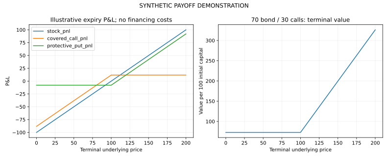

# Derivatives, Volatility and Portfolio-Risk Lab

A quantitative-finance project exploring European option valuation, hedging and structured-product payoffs.

## Provenance

The documented 2024 coursework included VXX and equity volatility, option-pricing and hedging prototypes, trading-rule analysis and structured-product design. Some original code was incomplete or used illustrative market inputs. This public edition is a new October 2026 reconstruction of the core pricing and payoff methods, not a recovered copy of the original multi-stock implementation.

## Included methods

- European Black-Scholes call/put valuation with continuous dividend yield.
- Delta and implied-volatility inversion with option-bound checks.
- Cox-Ross-Rubinstein binomial pricing and seeded Monte Carlo valuation.
- Covered-call and protective-put P&L.
- A 70-bond/30-call allocation's terminal payoff.



## Run

```bash
python -m pip install -r requirements.txt
python -m unittest -v test_pricing.py
python pricing.py --output demo_output
```

Seven checks cover put-call parity, expiry/zero-volatility limits, volatility inversion, invalid prices, finite-difference delta, independent numerical pricing and the protective-put floor.

## Interpretation

All included pricing inputs and scenarios are illustrative. Models assume European exercise, constant rates/volatility and no transaction costs. Payoff charts subtract nominal initial outlay without financing costs. A 70-percent bond allocation is not full principal protection.

## Attribution

Arinjai Das. Original coursework/research period: June-July 2024. Public reconstruction: October 2026, developed with ChatGPT assistance.
