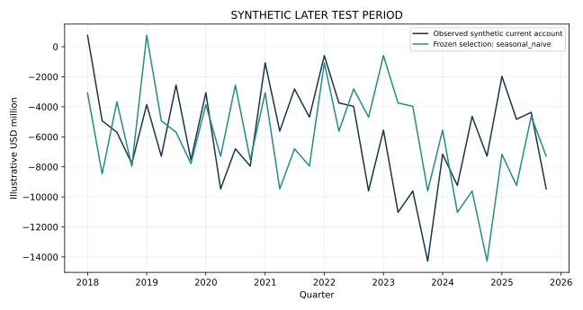

# Results walkthrough

All values below are synthetic or illustrative workflow results.

| Method | Later-test MAE | Later-test RMSE | MASE | Frozen selection |
| --- | --- | --- | --- | --- |
| ar1 | 2624.82 | 3264.55 | 0.935607 | False |
| ridge_var | 2625.1 | 3191.02 | 0.93586 | False |
| seasonal_naive | 3096.27 | 3658.24 | 1.10157 | True |

Validation selected **seasonal_naive**. On this seeded later test, other candidates can score better. The earlier selection is retained, preserving the distinction between model selection and honest later evaluation. Final point forecasts are in forecast_components.csv.

The numerical files in [demo_output](../demo_output/) are the authoritative bundled artifacts. Re-run the entry command to reproduce the workflow. Figure metadata can differ across renders even when the underlying numerical example is unchanged.
